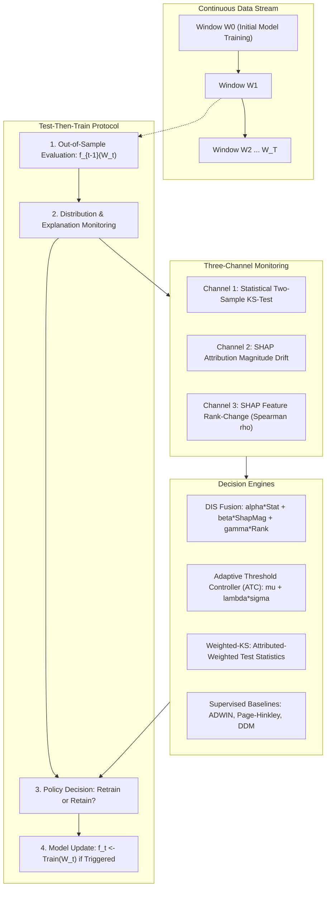

# DRIFT-X: Technical Architecture & Methodology Overview

DRIFT-X is a rigorous scientific framework and experimental benchmark for evaluating continual model maintenance and selective retraining triggers under non-stationary data streams.

---

## 🏗️ Methodological Principles

Evaluating continual retraining policies is fraught with methodological traps. DRIFT-X addresses four core evaluation hazards:

1. **Matched Operating Budgets:** Policies that trigger retraining frequently achieve higher predictive accuracy simply by consuming more fresh training data. DRIFT-X constructs dual-anchored continuous operating curves across dense parameter grids, interpolating performance at matched integer retraining budgets ($B \in \{1, 2, \dots, 10\}$) and evaluating the overall curve Area Under the Curve (AUC).
2. **Prequential (Test-Then-Train) Evaluation:** Data in incoming temporal window $\mathcal{W}_t$ is first used to evaluate the currently deployed model $f_{t-1}$ out-of-sample. Only after honest evaluation metrics are logged is retraining triggered to produce $f_t$ for future window $\mathcal{W}_{t+1}$.
3. **Decoupled Benchmark Architecture:** Eliminates the synthetic generator bleed-through artifact by strictly isolating concept drift dynamics ($X_{0:5}$) from harmless covariate drift ($X_{6:14}$), preventing false attribution-weighted alarms.
4. **Pre-Registered Multiplicity Control:** All confirmatory tests are pre-declared prior to running confirmatory seeds (`HYPOTHESIS_v3.md`), evaluated with two-tailed Wilcoxon signed-rank tests, 95% bootstrap confidence intervals, and family-wise error rate control via the Holm-Bonferroni step-down procedure.

---

## 📦 Evaluated Retraining Policies (P0 – P14)

| Policy ID | Policy Name | Supervision | Decision Mechanism |
|:---|:---|:---|:---|
| **P0** | Never-Retrain | None | Baseline: Model trained on $\mathcal{W}_0$, never updated. |
| **P1** | Fixed-Schedule | None | Periodic: Retrain every $k$ windows regardless of data. |
| **P2** | Drift-Only (KS) | Label-Free | Univariate Kolmogorov-Smirnov tests across all features with Bonferroni correction. |
| **P3** | SHAP-Magnitude | Label-Free | Mean absolute TreeSHAP attribution shift on unlabeled batch. |
| **P4** | SHAP-Rank-Change | Label-Free | Spearman rank correlation of feature attributions between windows. |
| **P5** | DIS-Fused | Label-Free | Fuses statistical KS distance, attribution magnitude, and rank shift. |
| **P6** | Performance-Trigger | **Label-Using** | Error-rate thresholding on immediate verification labels. |
| **P7** | Weighted-KS | Label-Free | Importance-weighted KS test statistics weighted by model attributions. |
| **P8** | Random-Budget | None | Uniform random retraining matched to expected budget. |
| **P9** | SHAP-Loss | **Label-Using** | Attribution of true log-loss degradation using verification labels. |
| **P10** | ADWIN | **Label-Using** | Adaptive Windowing on streaming classification error. |
| **P11** | DDM | **Label-Using** | Drift Detection Method tracking error rate standard deviations. |
| **P12** | KSWIN | Label-Free | Kolmogorov-Smirnov test on model output probabilities. |
| **P13** | Page-Hinkley | **Label-Using** | Cumulative sequential test on prediction residuals. |
| **P14** | Oracle | Full Info | Retrains exactly at true known concept change points. |

---

## 🔬 Core Empirical Findings

1. **No Detectable Difference Among Label-Free Triggers:**
   - On decoupled streams ($N=30$), paired comparisons between importance-weighted KS (P7), DIS-fusion (P5), and unweighted KS (P2) yield no statistically significant difference (Holm $p \ge 0.673$).
   - Bootstrap 95% confidence intervals at budget 4 (Acc@4) are $[-0.0015, +0.0258]$ for P5 vs P2 and $[-0.0048, +0.0207]$ for P7 vs P2. While true parity is not shown, differences beyond $\pm 0.01$ on AUC and $\pm 0.02$ on Acc@4 are ruled out by the data.
2. **Fixed Schedule Parity:**
   - No label-free detector outperforms a simple periodic retraining schedule at matched budget (Holm $p = 0.955$ on AUC, $1.000$ on Acc@4).
3. **The Coupled Generator Artifact:**
   - In coupled benchmark generators, when formerly informative features rotate out of the concept pool and begin drifting, importance-weighted tests detect 93.2% of invisible concept shifts. In decoupled generators, recall collapses to 45.2% (chance: 43.4%).
4. **Supervised vs. Label-Free:**
   - Under matched budgets at Acc@4, Page-Hinkley (P13) decisively outperforms label-free triggers by +3.1 to +3.5% (Holm $p \le 0.006$), whereas ADWIN does not achieve statistical significance at Acc@4 (Holm $p \ge 0.145$).
5. **Real Stream Sensitivity Disparities:**
   - On NOAA Weather, unweighted KS triggers in only 7 of 19 windows, while SHAP-weighted policies trigger in 18–19 of 19 windows (20 vs 29–30 on ELEC2). Importance weighting dramatically heightens sensitivity to organic distribution shifts.
